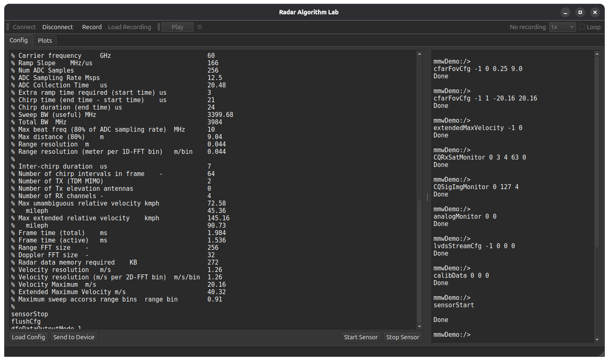
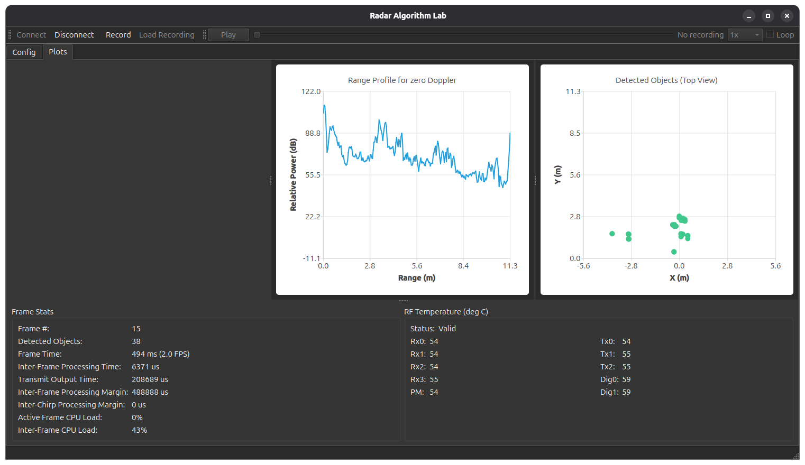

# radar-algorithm-lab


| Config | Plots |
| :---: | :---: |
|  |  |


## Build and run

- Developed using qt 6.11.

```bash
cmake -S . -B build -DCMAKE_BUILD_TYPE=Debug
```
```bash
cmake --build build -j$(nproc)
```
```bash
./build/radar_algorithm_lab
```

## References

[TI mmWave Demo Visualizer](https://dev.ti.com/gallery/view/mmwave/mmWave_Demo_Visualizer/ver/3.6.0/)

[TI mmWave-sdk 3.6.2 LTS](https://www.ti.com/tool/download/MMWAVE-SDK/03.06.02.00-LTS)